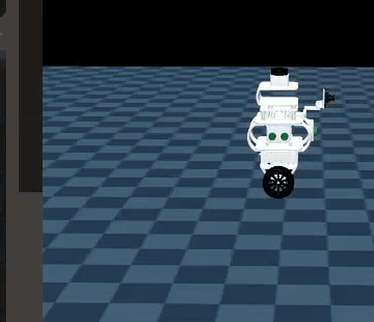
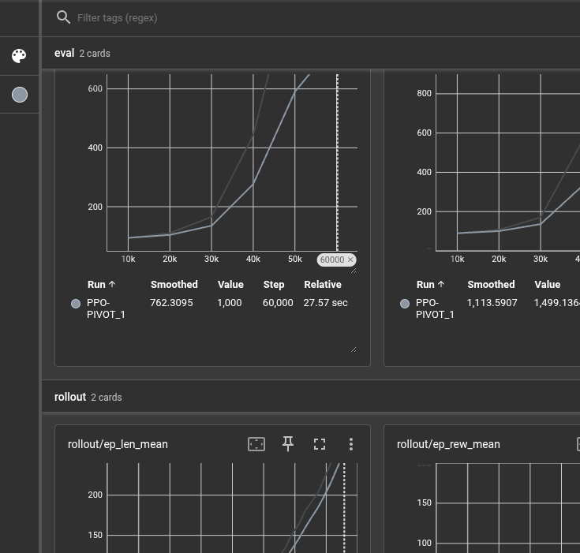
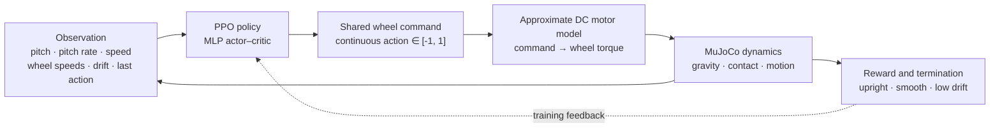
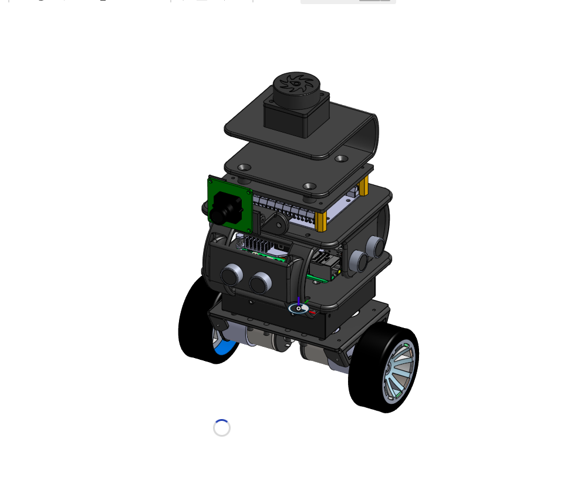
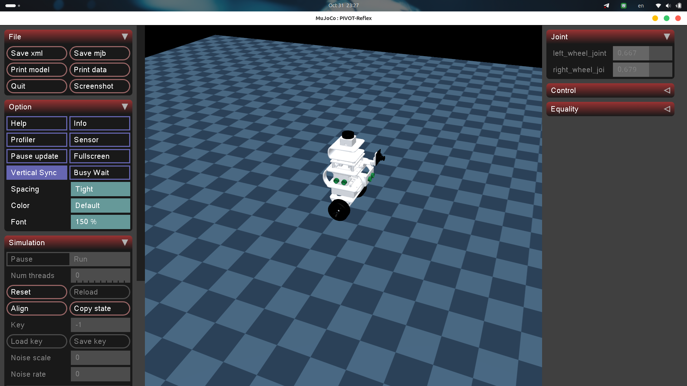

# ⚖️ RL Balancing for 2 wheeled Robot

### PPO-Based Autonomous Balancing for PIVOT

**Learning to stand. Learning to recover.**

[**GitHub Repository**](https://github.com/Muhd-Mahmud/RL-Balancing-for-2-wheeled-Robot) · [**Author Profile**](https://github.com/Muhd-Mahmud) · [**Issues**](https://github.com/Muhd-Mahmud/RL-Balancing-for-2-wheeled-Robot/issues) · [**Releases**](https://github.com/Muhd-Mahmud/RL-Balancing-for-2-wheeled-Robot/releases)

A reinforcement-learning controller for a **CAD-designed, two-wheeled inverted-pendulum robot**, trained in **MuJoCo** with **Proximal Policy Optimization (PPO)**. **PIVOT has not yet been physically built.**

    [](LICENSE)



Actual PIVOT-Reflex MuJoCo viewer recording. Simulation footage; not a hardware demonstration.

**[Overview](#overview)** · **[Results](#stage-1-results)** · **[Robot](#robot-and-simulation-model)** · **[Quick start](#quick-start)** · **[Roadmap](#research-roadmap)** · **[Publish](#publish-v010)**

---

## Overview

**PIVOT-Reflex** explores whether a neural-network policy can autonomously stabilize **PIVOT**, a two-wheeled inverted-pendulum robot, without relying on a hand-tuned PID controller for its learned action selection.

The project is separate from PIVOT’s ROS 2 / Gazebo navigation stack. It uses a standalone MuJoCo model generated from PIVOT’s URDF/Xacro description, a Gymnasium environment, and a continuous-control PPO agent implemented with Stable-Baselines3.

**Current milestone:** Stage 1 policy trained for **100,000 environment steps**, with successful nominal balancing, initial-tilt recovery and exploratory push tests **in simulation**. The physical robot is not built yet; hardware assembly, calibration and physical deployment are future work.

## Stage 1 results

| **100%** | **10.0 s** | **0.196°** | **9.9 cm** |
| :---: | :---: | :---: | :---: |
| Nominal evaluation success | Mean episode duration | Mean pitch RMSE | Mean absolute **final** displacement |

Deterministic evaluation of the saved best policy over 50 episodes with randomized resets. These values describe the nominal simulator, not the physical robot.

### Evaluation summary

| Experiment | Protocol | Observed result |
| :--- | :--- | :--- |
| Nominal balance | 50 independently seeded, 10-second episodes | **50/50 successful**; 0.196° mean pitch RMSE |
| Initial tilt | ±3°, ±5°, ±10°, ±15° | **8/8 survived** the full 10 seconds |
| Single external push | −6 to +6 N, 0.15 s at 2 s | **7/7 survived**; peak displacement up to **0.780 m** |
| Repeated pushes | Four scheduled pushes in each of 10 trials, up to ±6 N, 20-second episodes | **10/10 survived**; worst peak drift **0.815 m** |
| Late settling after repeated pushes | Mean absolute speed over each trial’s last 2 seconds | **0.102 m/s** average across 10 trials |

The external-force test also applied an approximate pitch moment of `force × 0.10 m`. These are scripted **simulation disturbances**, not measured physical impacts. Survival means the episode reached its time limit without triggering the environment’s fall/position termination conditions; it does **not** prove optimal position recovery.

**What still needs work:** The Stage 1 policy can tolerate repeated pushes but sometimes continues moving afterward. Stage 2 will target faster settling and lower peak displacement, not merely longer survival.

**Training progress in TensorBoard**



The nominal evaluation reached the **1,000-step episode ceiling** (10 seconds at 100 Hz). Stochastic training rollouts were shorter, as expected when PPO continues exploring.

## How it works



| Component | Stage 1 configuration |
| :--- | :--- |
| Physics engine | MuJoCo; timestep **0.002 s** (500 Hz) |
| Policy control | One action every **5 physics steps** (100 Hz) |
| RL algorithm | PPO, MLP actor–critic (`64 × 64` hidden units) |
| Observations | **7**: pitch, pitch rate, forward velocity, left/right wheel speeds, forward displacement, previous action |
| Actions | **1** normalized continuous command, shared by both wheel motors |
| Motor model | Provisional speed-dependent Yahboom MD520Z30-style torque model |
| Reset | Random pitch ±5°, random pitch rate ±0.15 rad/s |
| Reward | Upright stability with penalties for angular velocity, speed, drift, wheel speed and effort |
| Episode | Up to **10 s**; early termination for excessive tilt, roll, low body height or drift |

The policy controls **balance**, not steering or trajectory tracking. Left and right wheels currently receive the same high-level action. The observation includes simulated forward displacement, which would require estimation from wheel odometry on hardware.

## Robot design and MuJoCo simulation

| CAD concept — PIVOT design | MuJoCo — simulated PIVOT |
| --- | --- |
|  |  |

Both images represent design/simulation work. Neither is a photograph of a physical robot.

The MJCF model was generated from the supplied PIVOT URDF/Xacro and STL meshes. Training uses lightweight collision primitives; the visual model loads rendered STL geometry.

| Physical parameter | Model value |
| :--- | ---: |
| Main body mass | 1.225 kg |
| Wheel mass | 0.0988 kg per wheel |
| Wheel radius | 0.0335 m |
| Wheel-center separation | 0.158 m |
| Body COM above `base_link` origin | 0.0583 m |
| Planned motors / simulated motor specification | Two 12 V, 30:1 520 gearmotor-class units |
| Simulated peak torque cap | **0.20 N·m per wheel** (assumed, not measured) |

> \[!IMPORTANT\]  
> PIVOT is **currently a CAD and simulation project**. The motor torque–speed curve, motor driver response, mass distribution, friction, and sensor behavior are **provisional simulation approximations**, not calibrated measurements from assembled hardware. Do not treat Stage 1 performance as evidence of sim-to-real readiness.

### Hardware build status

**Not built yet.** The image above is a **CAD design rendering**, while the checkerboard image and animated demo show **MuJoCo simulation**. There is no physical-robot photo, hardware test, or real-world balance result to report at this stage.

The planned hardware phase includes fabrication/assembly, motor and driver integration, IMU and encoder calibration, and measured model-parameter identification. These are future milestones, not completed work.

When the physical prototype exists, this section can be expanded with an actual photo, measured specifications, safety procedures, and on-robot evaluation results.

## Quick start

### 1\. Install

```bash
# From the PIVOT-Reflex project root
git clone https://github.com/Muhd-Mahmud/RL-Balancing-for-2-wheeled-Robot.git
cd PIVOT-Reflex
python3 -m venv .venv
source .venv/bin/activate
python -m pip install -r requirements.txt
```

You need Python, an OpenGL-capable desktop for the viewer, and the dependencies in `requirements.txt`. ROS 2 and Gazebo are **not required** for the standalone training loop.

### 2\. Build and validate the MuJoCo models

```bash
python scripts/build_mjcf.py
python scripts/smoke_test.py --visual
python scripts/watch.py --mode zero    # Should fall without active control
python scripts/watch.py --mode pd      # Diagnostic controller, not optimized
```

`build_mjcf.py` regenerates **both** `models/pivot_train.xml` and `models/pivot_visual.xml` from the project assets. The current scene has a dark checkerboard ground for easier motion visualization.

### 3\. Train a new PPO policy

```bash
python scripts/train.py --timesteps 100000
```

In a second terminal:

```bash
tensorboard --logdir logs
# Open http://localhost:6006
```

The training script starts a **new** PPO run. It saves `checkpoints/best_model.zip` from periodic evaluation and `checkpoints/pivot_ppo_final.zip` at the end. **Save a copy of a successful checkpoint before rerunning training**, because these paths can be replaced.

### 4\. Evaluate and watch

```bash
python scripts/evaluate.py --episodes 50
python scripts/watch.py --mode ppo

# To test a specific checkpoint:
python scripts/evaluate.py --policy checkpoints/pivot_stage1_baseline.zip --episodes 50
python scripts/watch.py --mode ppo --policy checkpoints/pivot_stage1_baseline.zip
```

The evaluation summary is written to `results/evaluation.json`. **Trained checkpoint weights are not included in this repository by default** and must either be trained locally or provided as a separately published release asset.

## Project structure

```text
RL-Balancing-for-2-wheeled-Robot/
├── assets/
│   ├── urdf/                 # Source PIVOT Xacro
│   └── meshes/               # Optimized visual STL assets
├── models/
│   ├── pivot_train.xml       # Fast physics model
│   └── pivot_visual.xml      # Mesh-based visual model
├── configs/
│   └── motor_md520z30.json   # Motor profile / assumptions
├── envs/
│   ├── pivot_balance_env.py  # Gymnasium task, observations and reward
│   └── motor_model.py        # Approximate motor torque-speed response
├── scripts/
│   ├── build_mjcf.py         # Generate MJCF
│   ├── smoke_test.py         # Check physics and reset
│   ├── train.py              # PPO experiment
│   ├── evaluate.py           # Deterministic evaluation
│   └── watch.py              # MuJoCo viewer: zero / PD / PPO
├── docs/media/               # CAD design, MuJoCo screenshot/demo, TensorBoard figure
├── checkpoints/              # Local model files (gitignored)
├── logs/                     # TensorBoard logs (gitignored)
├── results/                  # Generated evaluation JSON (gitignored)
├── LICENSE                   # MIT license
├── README.md
└── requirements.txt
```

## Research roadmap

-   [x] **Stage 1 — Nominal autonomous balancing:** train PPO and evaluate initial-tilt and push survival in simulation.
-   [x] **Stage 2 — Robust disturbance recovery:** train with repeated/random pushes, longer episodes, and recovery-aware rewards.
-   [ ] **Stage 3 — Dynamics randomization:** vary inertia, friction, motor strength, sensor noise, and latency; quantify transfer robustness.
-   [ ] **Stage 4 — Balancing while moving:** separate wheel commands for forward/reverse velocity tracking and steering.
-   [ ] **Stage 5 — Build and sim-to-real validation:** assemble the physical PIVOT prototype; measure and calibrate dynamics; implement safety fallback and hardware protections; then evaluate on hardware.

**Benchmarking plan:** Compare learned policies with a properly tuned classical controller under *matched* initial states, pushes, and actuator constraints. The preliminary PD experiments (about 1.74 s average survival for ±3° starts) are only debugging baselines, **not a controlled head-to-head benchmark**.

## Limitations and reproducibility

-   Results reported above were observed on the current **nominal MuJoCo model**. Hardware behavior is not validated.
-   Disturbance protocols used scripted external wrench inputs; more realistic contact pushes and varying conditions remain future work.
-   The Stage 1 success metric counts episodes reaching the configured time limit; additional stability and recovery metrics are needed.
-   The robot’s simulated mass/inertia values come from the supplied Xacro. No physical PIVOT has been built, so the model is not yet calibrated against measurements from the assembled robot.
-   Exact replay requires the saved policy checkpoint and matching model/environment versions. Keep release-specific configs and checkpoints together.


## License and author

**MIT licensed.** See [LICENSE](LICENSE) for the full text. Original PIVOT-Reflex code is released under the MIT License; independently licensed dependencies and any third-party assets remain governed by their own terms.

**Maintained by [Muhd-Mahmud](https://github.com/Muhd-Mahmud).** Feedback and bug reports can be shared via [GitHub Issues](https://github.com/Muhd-Mahmud/RL-Balancing-for-2-wheeled-Robot/issues) after the repository is published.

## References

-   [MuJoCo documentation](https://mujoco.readthedocs.io/en/stable/)
-   [Stable-Baselines3 PPO](https://stable-baselines3.readthedocs.io/en/master/modules/ppo.html)
-   [Gymnasium](https://gymnasium.farama.org/)
-   [Yahboom SBR-STM32 documentation](https://www.yahboom.net/study/SBR-STM32)

---

**[PIVOT-Reflex](https://github.com/Muhd-Mahmud/PIVOT-Reflex)** · by **[Muhd-Mahmud](https://github.com/Muhd-Mahmud)**  
[MIT License](LICENSE) · [Issues](https://github.com/Muhd-Mahmud/PIVOT-Reflex/issues) · [Releases](https://github.com/Muhd-Mahmud/PIVOT-Reflex/releases)  
*Stage 1 complete in simulation · Stage 2 in development*
